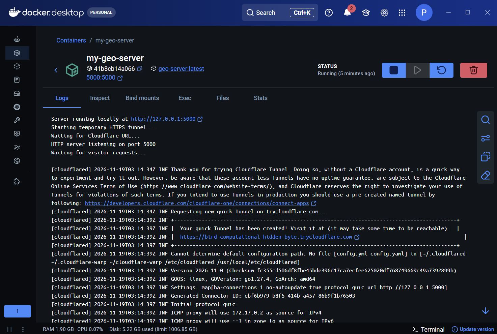
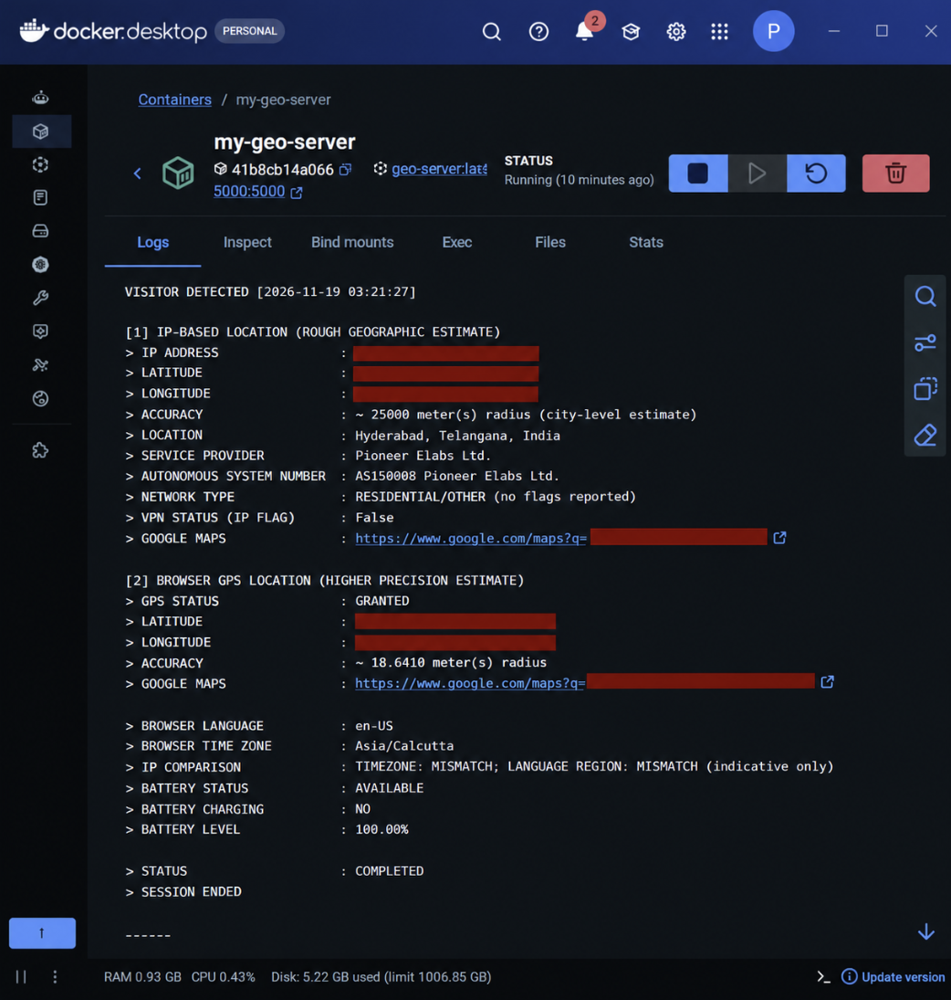

# Geo Tracker

Geo Tracker is a small Python app that shows a web page and collects some location and browser details. It asks for GPS permission, estimates location from the visitor's IP address, and prints the results in the server terminal. The page then redirects to an Instagram Reel.

IP location is only an estimate. GPS details are collected only if the visitor allows it.

## Screenshots

### App running in Docker



### Example visitor results (redact for privacy)



## Run on your computer

You need:

- Python 3.12 +
- Git
- `cloudflared` if you want a public HTTPS link
- Docker (optional to run a consistent environment)

No extra Python packages are needed.

```powershell
git clone https://github.com/prajwal2867/geo-tracker.git
cd geo-tracker
python app.py
```

Open [http://localhost:5000](http://localhost:5000). If `cloudflared` is installed, the terminal also shows a public link. Press **Ctrl+C** to stop the app.

## Run with Docker

Docker runs the app and tunnel together in the background. You need Docker Desktop running.

In the project folder, run:

```powershell
docker build -t geo-tracker .
docker run -d --name geo-tracker --restart unless-stopped -p 5000:5000 geo-tracker
```

To see the public link and visitor results:

```powershell
docker logs -f geo-tracker
```

Press **Ctrl+C** to stop viewing the logs. The app keeps running. To stop and remove the container:

```powershell
docker stop geo-tracker
docker rm geo-tracker
```

Only use the public tunnel with visitors who know what information the app requests and agree to share it.
